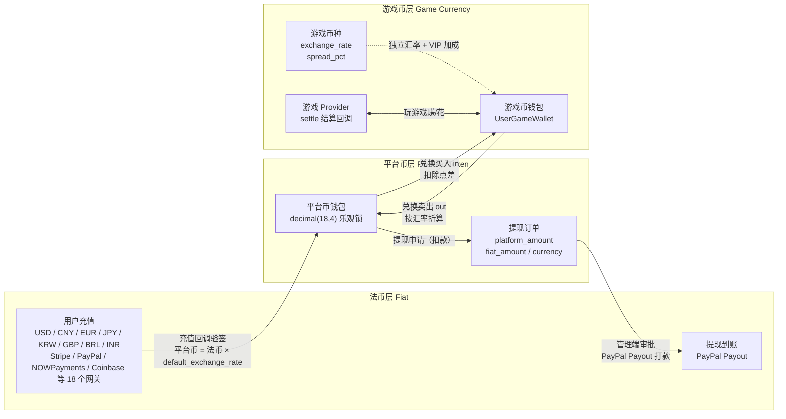
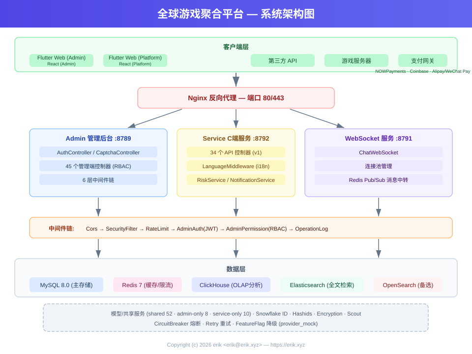
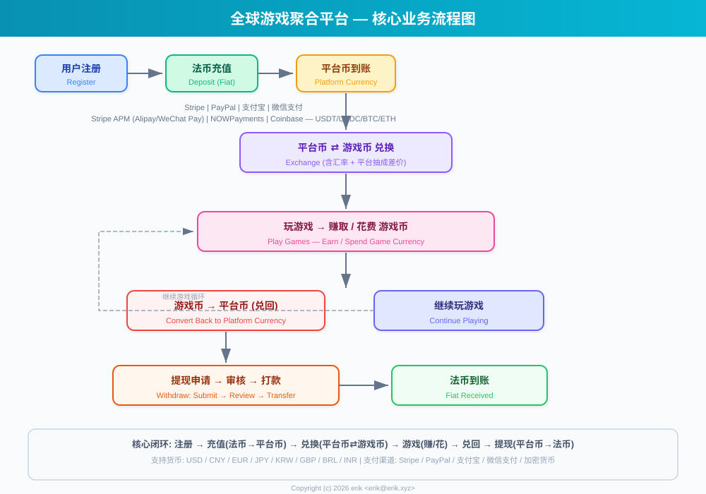
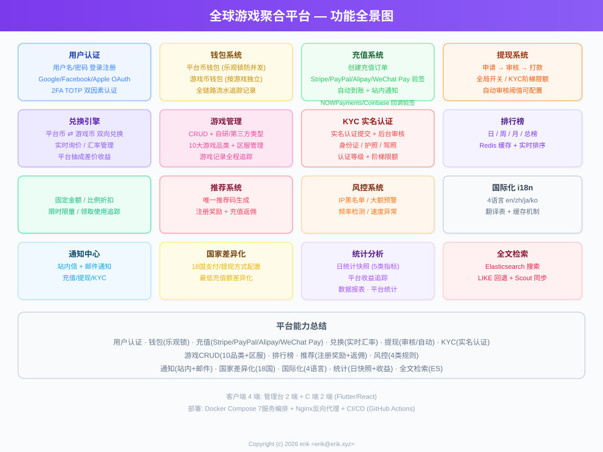
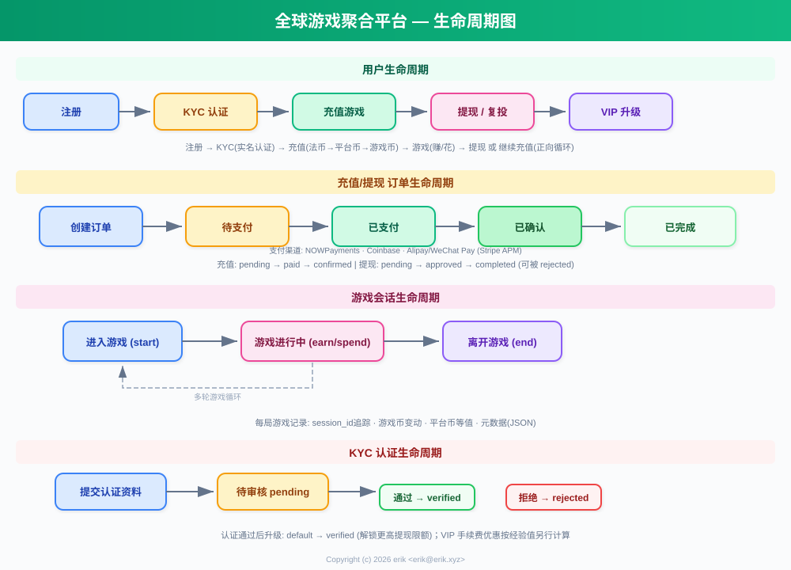
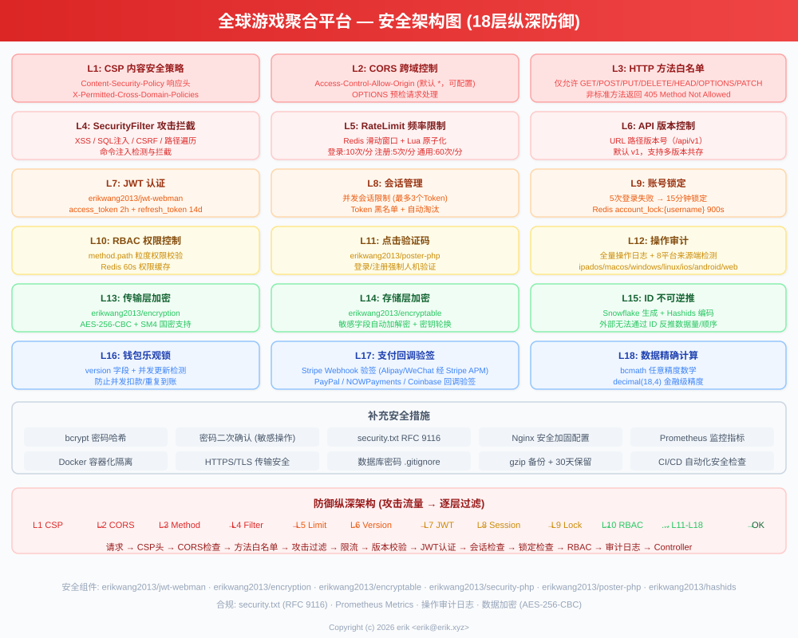
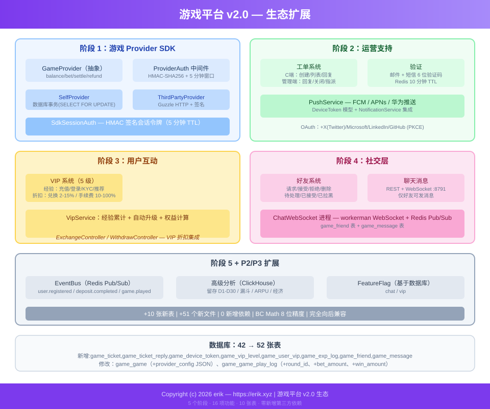

# 全球游戏聚合平台 (Global Game Platform)


Languages: **中文** · [English](docs/translations/README.en.md)


> Copyright (c) 2026 erik erik@erik.xyz — https://erik.xyz

全球通用、国际化的游戏聚合平台。用户注册后在平台充值兑换游戏币，用游戏币玩游戏、赚取游戏币，游戏币可转回钱包提现。后台提供完整的游戏管理、提现审核、用户管理和支付管理功能。支持多语言切换（13 语言）。


**小骰（Dicey）** — 平台吉祥物。骰子代表游戏与概率玩法，金币代表平台经济与多支付网关，紫色主色调呼应后台品牌。SVG 源文件：`docs/mascot.svg`，可无限缩放用于文档、Logo 与周边。

## 版本策略

| 版本 | 目标 | 状态 |
|------|------|------|

## 技术栈

### 后端
- PHP 8.3+, webman v2 (workerman/webman)
- MySQL 8.0+ (表前缀 `game_`，BIGINT 非自增主键)
- Redis (Session / 缓存 / 限流)
- ClickHouse (OLAP 分析 / 概率计算)
- Elasticsearch (全文检索)
- JWT 认证 + RBAC 权限控制
- 数据加密：API 传输层 AES-256-CBC + 数据库存储层 AES-128-ECB

### 前端

前端分两套目录树，**各自只调用自己那一侧的后端**，互不交叉：

| 目录树 | 定位 | 请求前缀 | 对应后端 | 技术栈 |
|--------|------|---------|---------|--------|

- 响应式布局 (Phone / Tablet / Desktop)
- 国际化 (i18n)：13 语言切换

### 核心组件
- `erikwang2013/snowflake-php` — 全局唯一 BIGINT ID 生成
- `erikwang2013/hashids` — API 层 ID 加解密
- `erikwang2013/jwt-webman` — JWT 认证
- `erikwang2013/encryption` — API 敏感数据加解密
- `erikwang2013/encryptable` — 数据库敏感字段加解密
- `erikwang2013/webman-scout` — Elasticsearch 同步与查询
- `erikwang2013/season` — 国家旗帜
- `erikwang2013/security-php` — 安全工具检测
- `erikwang2013/poster-php` — 敏感操作随机验证
- `erikwang2013/clickhouse-php` — ClickHouse 连接与概率计算

## 项目结构

```
game-platform-php/
├── admin/                     # 管理后台 (webman v2, 默认端口 8789，APP_PORT 可配)
│   ├── app/admin/v1/controller/  #   管理端控制器
│   ├── app/middleware/        #   中间件 (Cors/SecurityFilter/RateLimit/AdminAuth/AdminPermission/OperationLog)
│   ├── app/model/             #   仅 admin 独有的模型 (6 个，其余 51 个共享模型在 packages/)
│   ├── app/service/           #   仅 admin 独有的服务 (WalletService/WalletScope/RiskSandboxService)
│   ├── app/process/           #   常驻进程 (Http/Monitor/RiskIpCron/ExportTmpCleanup)
│   ├── app/provider/          #   游戏Provider层 (Self/ThirdParty/Factory)
│   ├── app/activity/          #   活动引擎 (签到/邀请/每日任务)
│   ├── config/                #   配置文件
│   └── apps/                  #   管理台前端（4 端，调 /admin/v1 → admin:8789）
│       ├── flutter/           #     Flutter Web PC 管理后台
│       ├── react/             #     React 19 (Vite) 管理台
│
├── service/                   # C端业务端 (webman v2, 默认端口 8792，APP_PORT 可配)
│   ├── app/api/v1/controller/ #   C端 API 控制器
│   ├── app/middleware/        #   中间件 (TraceId/Cors/SecurityFilter/RateLimit/LanguageMiddleware/UserAuth/ProviderAuth/SdkSessionAuth)
│   ├── app/model/             #   仅 service 独有的模型 (10 个，其余 52 个共享模型在 packages/)
│   ├── app/payment/           #   18 个支付网关适配器 (Stripe/PayPal/Adyen/NowPayments/Skrill…) + GatewayFactory
│   ├── app/provider/          #   游戏Provider层
│   ├── app/activity/          #   活动引擎
│   ├── app/event/             #   事件总线 (EventBus Redis Pub/Sub)
│   └── config/                #   配置文件
│
├── packages/platform-common/  # 共享层：admin 与 service 通过 composer path 仓库引入，避免两套副本
│   ├── src/model/             #   共享 Eloquent 模型 (51 个，两侧同源)
│   ├── src/service/           #   共享服务 (DepositLogService / VipService 等 12 个，含 ClickHouse 概率计算与 2 个基础设施类 EventPublisher/OutboxWriter)
│   ├── src/BcMath.php         #   金额/比率高精度运算 (bcmath 封装)、四舍五入、百分比
│   ├── src/EncryptionService.php  #   AES 加解密与脱敏
│   ├── src/CircuitBreaker.php #   熔断 (另有 Retry.php 重试)
│   ├── src/HashidsService.php #   API 层 ID 编解码
│   └── src/SnowflakeService.php   #   全局唯一 BIGINT ID
│
├── apps/                      # C 端玩家端前端（4 端，调 /api/v1 → service:8792）
│   ├── flutter/platform/      #   Flutter Web PC C端用户平台
│   ├── react/                 #   React 19 (Vite) C端
│
├── game/xiaoxiaole/           # 内置小游戏「田园消消乐」：TypeScript + Vite + Vitest，src/domain 领域引擎 + 四关设计 + tests/，13 语言设计文档
│
├── install/                   # 一键安装向导 + 数据库初始化 SQL
│   ├── index.php              #   安装入口
│   ├── Installer.php          #   安装核心逻辑
│   ├── install.sql            #   合并安装 SQL（MySQL 全量：79张表+种子数据）
│   ├── clickhouse.sql         #   ClickHouse 分析库 DDL（独立引擎，单独导入）
│   ├── test-data.sql          #   演示/测试数据
│   ├── migrations/            #   存量库增量升级脚本 (*.sql)
│   ├── lang/ + lang.php       #   安装向导界面翻译 (13 语言)
│   └── assets/                #   静态资源
│
├── docs/                      # 项目文档（正文均为 13 语言：.md 为中文源，同目录另有 .{lang}.md 译本）
│   ├── ARCHITECTURE.md        #   架构文档
│   ├── ARCHITECTURE-DESIGN.md #   架构设计文档
│   ├── FEATURES.md            #   功能文档
│   ├── FEATURE-DESIGN.md      #   功能设计文档
│   ├── API.md                 #   接口文档
│   ├── DEPLOYMENT.md          #   部署文档（Docker/手动/端口配置）
│   ├── PROVIDER-SDK.md        #   第三方游戏接入指南（签名算法 + PHP/Go/Python 示例）
│   ├── CLICKHOUSE_INSTALL.md  #   ClickHouse 安装/配置/迁移/验证
│   ├── CLICKHOUSE_USAGE.md    #   4 个 ClickHouse 服务 API 与后台看板
│   ├── translations/          #   本 README 的 12 语言译本
│   ├── diagrams/              #   架构/流程/功能/生命周期/安全/生态扩展 SVG（各 13 语言）
│   ├── test-reports/          #   测试报告 (php-unit / api / resilience / ui / SUMMARY)
│   └── superpowers/           #   本仓库的设计规范与实现计划（历史记录）
│
├── scripts/                   # 运维脚本 (模型漂移检查 / apidoc 注解迁移 / 兑换出款语义迁移 / 签名验证)
├── tests/api/                 # API 接口自动化测试 (run_all.sh)
├── runtime/                   # webman 运行时目录（日志/pid，运行时生成）
│
├── docker-compose.yml         # Docker Compose 编排（默认端口来自根 .env）
├── nginx.conf.template        # Nginx 配置模板（upstream 端口由 envsubst 渲染）
├── .env.example               # 根 .env 模板（Docker 端口变量，cp 为 .env 使用）
└── admin/docs/superpowers/    # 开发规范与计划
    ├── specs/                 #   设计规范
    └── plans/                 #   实现计划
```

## 快速开始

### 环境要求
- PHP 8.1+
- MySQL 8.0+
- Redis 6.0+
- Composer 2.x
- Flutter SDK 3.x (前端，可选)

### 方式一：一键安装向导（推荐）

```bash
# 1. 启动安装向导
php -S 0.0.0.0:8888 -t install/

# 2. 浏览器打开 http://localhost:8888
#    按照向导完成：环境检查 → 数据库配置 → 管理员账户设置 → 自动安装

# 3. 安装依赖
cd admin && composer install && cd ..
cd service && composer install && cd ..

# 4. 启动服务（默认端口 admin 8789 / service 8792，可在各自 .env 的 APP_PORT 修改）
cd admin && php start.php start -d && cd ..
cd service && php start.php start -d && cd ..

# 5. 访问管理后台: http://localhost:8789（默认端口）
#    使用安装时设置的管理员账号密码登录

# 6. 安装完成后删除安装目录（安全）
rm -rf install/
```

安装向导会自动完成：
- 环境检查（PHP版本、扩展、目录权限）
- 创建数据库和数据表（合并 SQL，79 张表 + 种子数据）
- 创建超级管理员账户（bcrypt 加密）
- 自动生成 JWT/加密密钥并写入 .env 文件
- 生成 install.lock 防止重复安装

### 方式二：手动安装

#### 展开手动安装步骤

#### 1. 数据库初始化

```bash
# 一键导入合并 SQL
mysql -u root -e "CREATE DATABASE IF NOT EXISTS game-platform CHARACTER SET utf8mb4 COLLATE utf8mb4_unicode_ci;"
mysql -u root game-platform < install/install.sql
```

#### 2. 配置环境变量

```bash
# 管理后台
cd admin
cp .env.example .env
# 编辑 .env 中的数据库连接信息和密钥

# C端业务端
cd ../service
cp .env.example .env
# 编辑 .env 中的数据库连接信息和密钥
```

#### 3. 后端启动

```bash
cd admin && composer install && php start.php start -d
cd ../service && composer install && php start.php start -d
```

#### 4. 创建管理员

需要手动在数据库中插入管理员账户（密码使用 bcrypt 加密）。


### 前端启动（可选）

开发态各自起 dev server，请求由 dev server 代理到对应后端（见各目录的 `proxy.conf.json` / `vite.config.ts`）：

```bash
# --- C 端玩家端（/api/v1 → service:8792）---
cd apps/react            && npm install && npm run dev      # http://localhost:5173
cd apps/flutter/platform && flutter pub get && flutter run -d chrome

# --- 管理台（/admin/v1 → admin:8789）---
cd admin/apps/react      && npm install && npm run dev      # http://localhost:5273
cd admin/apps/flutter    && flutter pub get && flutter run -d chrome
```

> 模拟器访问宿主机后端用 `http://10.0.2.2:<端口>`（见各自 `ApiService.ets` 顶部常量）。

### 前端部署（Docker/Nginx）

`docker-compose.yml` 的 nginx 服务把各端构建产物只读挂载进容器，`nginx.conf.template` 按下列路径对外提供。
产物未构建时目录为空：路径请求返回 404，裸目录请求（如 `/app-react/`）返回 403。

| URL | 产物挂载点 | 构建命令 |
|-----|-----------|---------|
| `/` | `apps/flutter/platform/build/web` | `flutter build web` |
| `/app-react/` | `apps/react/dist` | `npm run build`（脚本内含 `--base=/app-react/`） |
| `/admin-panel/` | `admin/public` | 通用投放位：把任一控制台产物拷进 `admin/public` 即可；未放入时同样返回 404（裸目录 403）。注意产物须以 `--base=/admin-panel/`（Flutter 为 `--base-href=/admin-panel/`）构建，否则其资源仍指向原前缀而 404。无斜杠形式会 301 到本地址；`nginx.conf.template` 已设 `absolute_redirect off`，该跳转为相对 Location，非 80 端口部署不再丢端口 |
| `/admin-react/` | `admin/apps/react/dist` | `npm run build`（脚本内含 `--base=/admin-react/`） |
| `/admin-flutter/` | `admin/apps/flutter/build/web` | `flutter build web --base-href=/admin-flutter/` |


### 验证

```bash
# 测试管理后台（默认端口 8789）
curl http://localhost:8789/health

# 测试C端业务（默认端口 8792）
curl http://localhost:8792/health

# 测试用户注册
curl -X POST http://localhost:8792/api/v1/auth/register \
  -H "Content-Type: application/json" \
  -d '{"username":"testuser","password":"Abcdef12"}'
```

## 安全特性

- **18 层纵深防御**：XSS/SQL注入/CSRF/路径遍历/命令注入检测拦截
- **HTTP 方法白名单**：仅允许 GET/POST/PUT/DELETE/OPTIONS/HEAD/PATCH
- **JWT 认证**：access_token 2h + refresh_token 14d，并发会话限制
- **JWT 密钥启动校验**：admin 端 `ADMIN_JWT_SECRET_KEY`、service 端 `SERVICE_JWT_SECRET_KEY` 独立密钥，缺失或仍为默认值直接拒绝启动
- **支付回调 fail-closed**：provider 白名单（stripe/paypal/nowpayments/coinbase/skrill/neteller/paysafecard/paytm/mercadopago/astropay/paypay/kakaopay/gcash）+ 未配密钥/验签失败/时间戳超限一律拒绝 + bccomp 金额核对 + 回调入账事务化
- **RBAC 权限**：method.path 粒度权限控制，Redis 60s 缓存
- **点击验证码**：登录/注册强制人机验证
- **密码二次确认**：敏感操作需输入密码确认
- **数据加密**：传输层 AES-256-CBC + 存储层 AES-128-ECB
- **ID 加密**：Snowflake 生成 + Hashids 编码，外部不可逆推
- **钱包乐观锁**：防止并发扣款/重复到账
- **操作审计**：全量操作日志，8 平台来源端自动检测
- **限流**：Redis 滑动窗口，Lua 原子化
- **CSP 头**：Content-Security-Policy 防 XSS
- **账号安全**：连续5次登录失败锁定15分钟

## 测试

测试报告（本地存储）：[docs/test-reports/](docs/test-reports/)

| 测试类型 | 用例/覆盖 | 结果 |
|---------|----------|------|
| PHP 单元测试 | 现测 `phpunit --list-tests`：admin 593 + service 549 用例（报告 `docs/test-reports/php-unit.md` 记 09-22 复跑 admin 190 + service 273、08-27 快照 admin 153 + service 45；admin 侧后续补测） | service 全通过（701 断言、3 skipped、2 warnings + 35 deprecations）；admin 437 断言、3 skipped、1 例失败（`EnvConfigTest` 校验真实 `admin/.env` 缺少 `REDIS_CLUSTER_NODES`，补上即绿） |
| 稳定性机制测试 | 熔断/重试/降级开关 15 用例（CircuitBreakerTest/RetryTest/ResilienceMockTest） | 全部通过 |
| API 接口自动化 | 187 端点（来源：`docs/test-reports/api.md`，2026-08-27）；当前 route.php 注册 273 个端点（admin 164 + service 109） | 171 通过 / 50 失败 / 4 跳过（失败均为确定性缺陷，详见报告） |
| Flutter UI 测试 | 130 用例（登录/仪表盘/导航/语言切换） | 全部通过 |
| Go/Rust | 仓库无 Go/Rust 代码 | 跳过，已记录 |

```bash
# PHP 单元测试（需先导出 JWT 密钥环境变量）
cd admin && ADMIN_JWT_SECRET_KEY=test-jwt-secret-change-me php vendor/bin/phpunit
cd service && SERVICE_JWT_SECRET_KEY=test-jwt-secret-change-me php vendor/bin/phpunit
# API 接口自动化（需启动服务，详见 tests/api/run_all.sh）
bash tests/api/run_all.sh
# Flutter UI 测试
cd admin/apps/flutter && flutter test --timeout 300s
```

详细报告：
- [PHP 单元测试报告](docs/test-reports/php-unit.md)
- [稳定性机制测试报告（熔断/重试/降级）](docs/test-reports/resilience.md)
- [API 接口自动化报告](docs/test-reports/api.md)
- [Flutter UI 测试报告](docs/test-reports/ui.md)

## 平台能力总览

| 能力 | 说明 |
|------|------|
| 用户认证 | 用户名密码 + 7平台 OAuth (Google/Facebook/Apple/X(Twitter)/Microsoft/LinkedIn/GitHub) + 2FA TOTP |
| 钱包 | 平台币钱包(乐观锁) + 游戏币钱包 + 流水记录 |
| 充值 | 创建订单(回填 checkout_url/expires_at) + Stripe/PayPal/NowPayments/Coinbase 等 18 网关回调验签 + 自动到账 |
| 兑换 | 平台币⇄游戏币、实时询价、差价收益 |
| 提现 | 申请→审核→打款、全局开关、KYC阶梯限额+手续费 |
| KYC | 实名认证提交+审核、通过后提升提现限额 |
| 游戏 | CRUD + 分类(10类) + 区服 + 游戏记录追踪 |
| 搜索 | Elasticsearch 全文检索(含LIKE回退) |
| 排行榜 | 日/周/月/总榜、Redis缓存（实时推送未实现，WS 子系统已于 2026-10-02 移除） |
| 推荐 | 推荐码、注册奖励、充值返佣 |
| 风控 | IP黑名单/大额预警/频率/速度检测 |
| 风控纵深 | 设备指纹/IP信誉/账号关联图谱 + 规则引擎 + 风控看板 + AML/KYC/信任分 |
| 反作弊 | 反作弊事件采集 + 日统计 + 人工复核 |
| 统一钱包 | WalletScope 统一钱包作用域 |
| 活动引擎 | 活动创建/参与/奖励 + 签到 |
| 社交拉新 | 群组 + 分享链接追踪 |
| 支付网关 | Adyen / GrabPay 新增网关 (L1) |
| 国际化 | 13语言、翻译表+缓存 |
| 国家配置 | 18国差异化支付/提现方式、最低充值额 |
| 统计 | 日统计快照(5类指标) + 平台收益追踪 |
| 验证码 | 点击式人机验证(poster-php) |
| 游戏接入 | Provider SDK (Self+ThirdParty) + HMAC-SHA256 签名 + 回调网关 |
| 工单 | C端创建/回复 + 管理端处理/分配/关闭 |
| VIP | 5级忠诚度、经验值累计、兑换折扣/提现减免/汇率加成 |
| 社交 | 好友系统 + WebSocket 实时私信 (默认端口 8791，CHAT_WS_PORT 可配)、仅好友可发 |
| 返佣 | 二级推荐分润 (可配置佣金率) |
| 事件 | Redis Pub/Sub 事件总线 + Webhook订阅投递 (7种事件) |
| 部署 | Docker Compose 7 服务编排（端口由根 .env 配置） + Nginx反向代理 |

## 业务模型

```
法币 (USD/CNY/EUR...)
  │  充值(Stripe/PayPal/NowPayments/Coinbase 等/支付宝/微信)
  ▼
平台币 (统一，精度 decimal(18,4))
  │  兑换（含汇率 + 平台抽成差价）
  ▼
游戏币 (每种游戏独立，独立汇率)
  │  玩游戏赚/花
  ▼
平台币 ← 兑回 → 提现（审核/自动）
```

## 多币种结算

平台采用「法币 → 平台币 → 游戏币」三层币种隔离的结算体系：支持 USD/CNY/EUR/JPY/KRW/GBP/BRL/INR 多法币充值，每款游戏拥有独立计价币种；金额计算全程使用 bcmath 高精度运算，杜绝浮点误差。

### 三层币种模型

| 层级 | 币种 | 说明 |
|------|------|------|
| 法币层 | USD / CNY / EUR / JPY / KRW / GBP / BRL / INR | 用户充值/提现的实际支付货币，由 Stripe / PayPal / NOWPayments / Coinbase 等 18 个网关 处理 |
| 平台币层 | 平台币（全平台统一） | 内部统一结算货币（decimal(18,4)），钱包乐观锁防并发扣款/重复到账 |
| 游戏币层 | 每款游戏独立币种 | 每款游戏独立 `exchange_rate` 汇率与 `spread_pct` 点差，独立游戏币钱包 |

### 结算路径

- **充值结算**：用户以法币支付（Stripe / PayPal / NowPayments / Coinbase 等 18 个网关回调验签、幂等防重）→ 按 `default_exchange_rate` 换算平台币入账，充值订单同时记录 `amount + currency + platform_amount`
- **兑换结算**：平台币 ⇄ 游戏币按游戏币种汇率实时询价（quote），扣除 `spread_pct` 点差作为平台差价收益，VIP 享兑换折扣与汇率加成
- **游戏结算**：游戏 Provider 通过 `/api/provider/settle` 回调增减用户游戏币（HMAC-SHA256 签名），游戏会话超时自动结算
- **提现结算**：平台币扣款 → 生成提现订单（记录 `platform_amount / fiat_amount / currency`）→ 管理端审批 → PayPal Payout 打款 → 批次状态同步至完成

### 结算流程图



## 架构图



## 核心业务流程



## 功能全景



## 生命周期



## 安全架构



## 生态扩展 (v2.0)



## 文档索引

| 文档 | 说明 |
|------|------|
| [版本对比](docs/VERSIONS.md) | 基础版/标准版/完整版功能对比 |
| [架构设计文档](docs/ARCHITECTURE-DESIGN.md) | 架构选型理由与设计决策 |
| [架构文档](docs/ARCHITECTURE.md) | 系统拓扑、模块架构、数据流 |
| [功能设计文档](docs/FEATURE-DESIGN.md) | 业务模型、功能规格、流程设计 |
| [功能文档](docs/FEATURES.md) | 功能清单、模块说明、用户旅程 |
| [接口文档](docs/API.md) | 完整 API 参考 (146 个接口) |
| [在线文档](http://localhost:8792/apidoc/) | erikwang2013/apidoc-php 交互式文档 (C端) |
| [在线文档](http://localhost:8789/apidoc/) | erikwang2013/apidoc-php 交互式文档 (管理后台) |
| [ClickHouse 安装](docs/CLICKHOUSE_INSTALL.md) | ClickHouse 安装/配置/迁移/验证 |
| [Provider SDK 接入文档](docs/PROVIDER-SDK.md) | 第三方游戏接入指南 (签名算法+PHP/Go/Python示例) |
| [ClickHouse 使用](docs/CLICKHOUSE_USAGE.md) | 4 个 ClickHouse 服务 API 与后台看板 |
| [部署文档](docs/DEPLOYMENT.md) | 部署指南（Docker + 手动 + Nginx + 监控） |
| [设计规范](admin/docs/superpowers/specs/2026-05-22-game-platform-design.md) | 完整设计规范 |
| [实现计划](admin/docs/superpowers/plans/2026-05-22-game-platform-plan.md) | 详细实现计划 |

---

## 致谢

感谢安全研究者 **kta1kri** 通过外部安全报告负责任地披露自研 / 内嵌游戏结算铸币漏洞；该问题已于 v1.3.38 修复。

---

## 支持项目

如果这个项目对你有帮助，欢迎请作者喝杯咖啡 ☕

| 微信支付 | 支付宝 |
|---|---|
|  |  |

## 项目宠物表情形态 · Dicey

|  **笑** `:emoji-smile:` |  **欢乐** `:emoji-joy:` |  **哭** `:emoji-cry:` |  **沮丧** `:emoji-depressed:` |  **惊恐** `:emoji-terrified:` |  **愤怒** `:emoji-angry:` |
|---|---|---|---|---|---|
|  **撒娇** `:emoji-coquettish:` |  **卖萌** `:emoji-cute:` |  **讨好** `:emoji-pleasing:` |  **敲打** `:emoji-knocking:` |  **捂脸** `:emoji-facepalm:` |  **吐舌头** `:emoji-tongue:` |

> 12 种彩色动态形态：笑 / 欢乐 / 哭 / 沮丧 / 惊恐 / 愤怒 / 撒娇 / 卖萌 / 讨好 / 敲打 / 捂脸 / 吐舌头。每个 SVG 自带表情、情绪特效与整体动效，并遵循 `prefers-reduced-motion`。


## 视觉资产授权 / Visual Assets License

本项目的项目宠物、图片、图标、表情（包括 `docs/pet-expressions/` 等目录下的
SVG / PNG）**不是开源资产**，版权归作者所有。未经书面许可不得复制、修改、再分发或
用于商业用途；商业使用需取得商业授权，联系 **erik@erik.xyz**。详见
[ASSETS-LICENSE.md](ASSETS-LICENSE.md)。

> 代码部分仍遵循仓库原有 `LICENSE`；第三方素材（如明确标注的 Go Gopher 等）仍遵循其原许可证。


## 开源版 vs 商业版

本项目开源仓库保留可独立运行的游戏聚合平台核心能力；商业版面向需要完整运营工具、多端交付和商业授权的场景。

### 多维度对比

| 维度 | 开源版 | 商业版 |
|---|---|---|
| 功能覆盖 | 404 PHP 文件 / 75 控制器 / 56 模型 / 260 路由 / 67 表；核心聚合、Provider 接入、钱包/支付、风控/反作弊、活动、VIP/工单 | 438 / 82 / 68 / 291 / 79 表；增加优惠券、赛事、组队/公会、成就、对账/结算、CDN 五厂商 |
| 安全防护 | JWT + ProviderAuth + SdkSessionAuth、RBAC、RateLimit、SecurityFilter、2FA、9 类风控评估器、操作审计、敏感字段加密 | 同一套认证/风控/审计/加密中间件与评估器；未发现额外安全模块，增量集中在业务与客户端 |
| 性能与规模 | webman 常驻、Redis、Elasticsearch、7 个常驻进程、WebSocket `chat-ws` | 同栈；8 个常驻进程（多 `GroupSweepWorker`）；未发现 ClickHouse 运行时依赖，双方一致 |
| 数据与检索 | MySQL 67 表 + Redis + Elasticsearch；游戏/Provider/订单/钱包数据 | MySQL 79 表 + Redis + Elasticsearch；增加优惠券/赛事/组队/成就/对账/CDN 数据 |
| 测试与质量 | git 历史 160 个 PHP 测试 + 30 Flutter + 38 React；CI 覆盖 php-syntax、phpunit-admin、phpunit-service、React、Flutter、Release | 快照含 5 个 PHP 测试 + 30 Flutter + 38 React；CI 增加 `frontend-angular`；双方当前工作区测试文件均未检出 |
| 部署与运维 | Docker Compose 8 服务（nginx/admin/service/chat-ws/mysql/redis/ES）、健康检查、Prometheus metrics、7 进程 | 同 8 服务与健康/指标端点；8 进程；CI 增加 Angular 构建，部署拓扑一致 |
| 多端与国际化 | React 19 + Flutter（管理端/C 端各一套）；13 语种 | React 19 + Angular 21 + Flutter + HarmonyOS（管理端/C 端各一套）；13 语种 |
| 扩展性与二次开发 | ProviderFactory/GameProvider/ThirdPartyProvider + GameSdk + ProviderAuth；`/api/provider`、`/api/game`、`/api/v1` 版本化接口 | 同 Provider/SDK/版本化接口；额外提供赛事、组队、优惠券、对账、CDN 接口，扩展面更大 |
| 授权与商业支持 | 个人学习/研究；商业使用需书面授权 | 商业授权；交付、支持与报价联系 **erik@erik.xyz** |
| 适用场景 | 个人学习、研究、二次开发、小规模自建验证 | 需要完整运营营销、多端交付、对账结算与 CDN 的商业部署 |

### 商业版额外能力

- **运营营销**：优惠券（领取 / 核销 / 统计）、赛事、组队 / 公会、成就体系。
- **财务与基础设施**：对账 / 结算（批次 / 账单 / 差异）、CDN 五厂商管理（Cloudflare / CloudFront / 阿里云 / 腾讯云 / 华为云）。
- **多端交付**：Angular 21 与 HarmonyOS ArkTS 的管理端、C 端源码各一套。
- 上述模块均包含对应数据库表、后台菜单 / 权限、API 路由与前端页面。

### 开源版保留能力

游戏聚合、Provider 接入、钱包 / 支付、风控 / 反作弊、活动引擎、VIP / 工单、报表、RBAC、审计、多语言，以及 React + Flutter 两套客户端。

> 商业版授权与交付条款请联系 **erik@erik.xyz**。未经书面授权，禁止任何形式的商业使用。

**English:** The open-source edition keeps the core game aggregation platform with React/Flutter clients, the same JWT/RBAC/rate-limit/security-filter/2FA/risk/audit/encryption stack, MySQL + Redis + Elasticsearch, Docker Compose deployment, and 13-language i18n. The commercial edition adds coupons, tournaments, groups, achievements, reconciliation/settlement, CDN provider management, and Angular/HarmonyOS clients for both admin and C-end, with matching tables, permissions, routes and CI. Security middleware, risk evaluators and deployment topology are otherwise identical; no ClickHouse runtime dependency was found in either tree. Commercial licensing, delivery and support: **erik@erik.xyz**.

## 项目授权 / Project License

Copyright (c) 2026 erik erik@erik.xyz — https://erik.xyz

- 本项目仅供个人学习、研究使用。
- 未经作者书面授权，禁止任何形式的商业使用（包括但不限于商业部署、付费服务、二次销售、SaaS 运营及以本项目为基础提供商业服务）。
- 商业授权请联系 **erik@erik.xyz**。
- 未经授权的商业使用，作者将在全球范围内依法追究法律责任，并保留终身追责的权利。
- 第三方组件仍遵循其各自原有的许可证；视觉资产适用仓库内的 ASSETS-LICENSE.md（如适用）。

**English:** This project is provided for personal study and research only. Commercial use of any kind requires prior written authorization from the author (erik@erik.xyz). Unauthorized commercial use will be pursued for legal liability worldwide, and the author reserves the right to pursue such liability for life. Third-party components remain under their original licenses; visual assets are governed by ASSETS-LICENSE.md where applicable.
